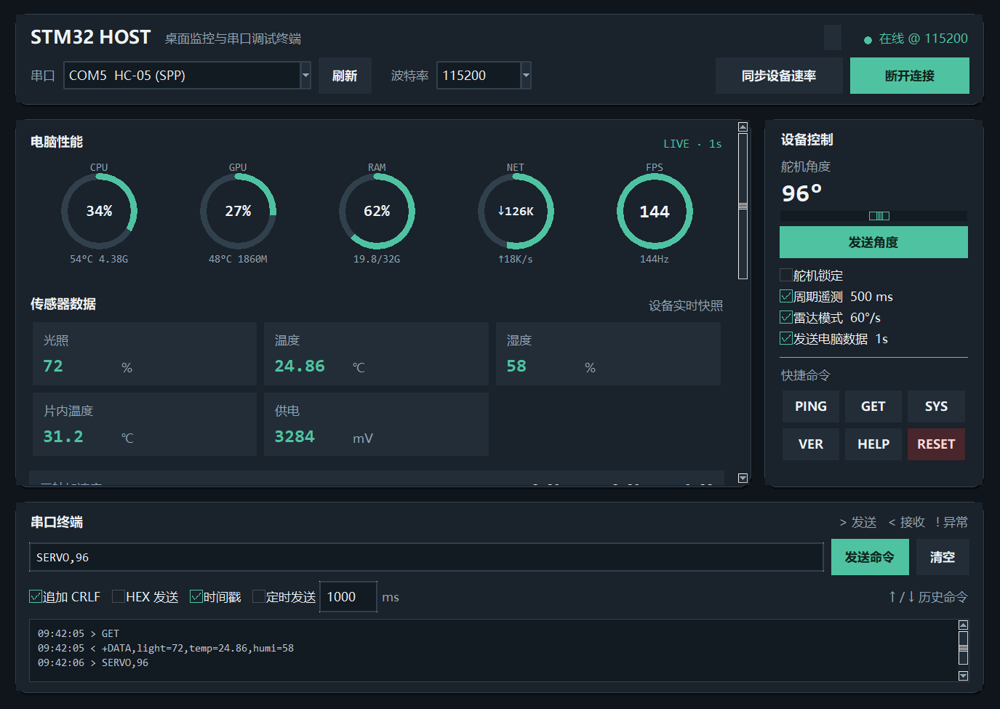
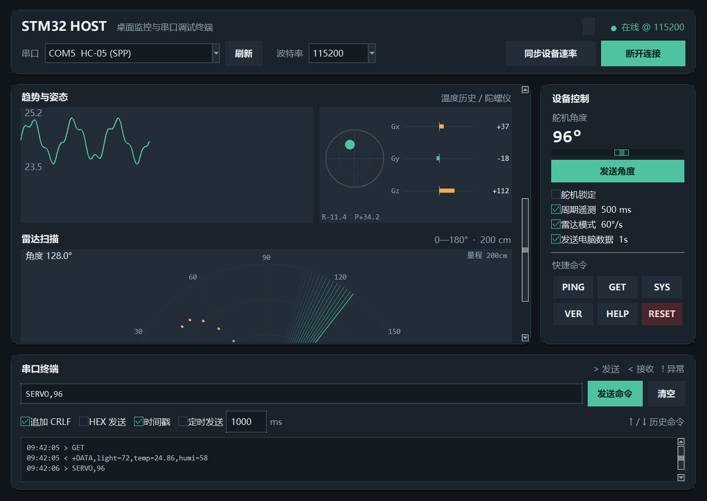
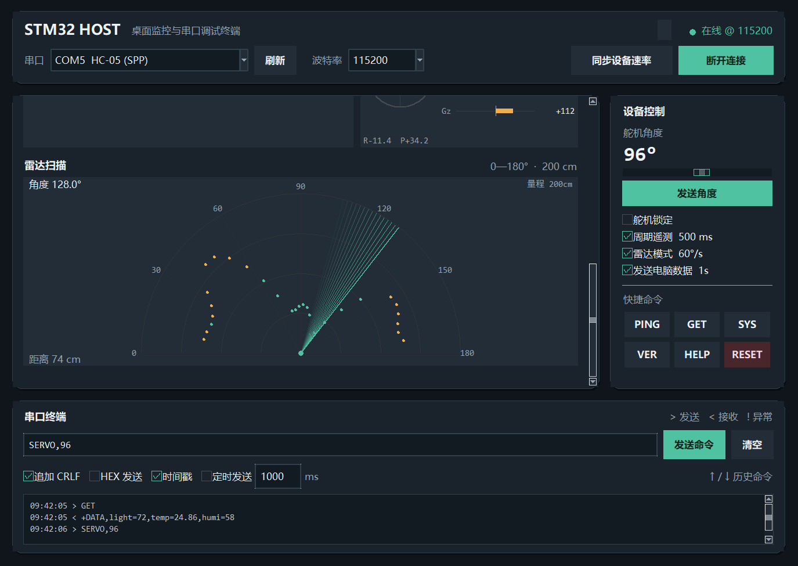

# STM32 蓝牙上位机

配套 STM32F103 桌面终端项目的 PC 端工具：通过 HC-05 / HC-06 蓝牙串口（或 USB-TTL）查看传感器数据、控制舵机、调试通信协议。

- GitHub 仓库：<https://github.com/b-as-h/Host_computer-py>
- 固件协议：`Core/Src/bt.c`、`Core/Inc/bt.h`（固件工程不在本仓库）
- 界面技术：Python + Tkinter，无前端构建步骤
- 显示适配：Windows Per-Monitor V2 DPI，1080p / 2K 自适应

---

## 界面预览

以下截图全部由 [`tools/capture_screenshots.py`](tools/capture_screenshots.py) 使用固定虚拟数据生成，不需要开发板、串口或本机真实性能数据。

### 主界面



### 温度曲线与陀螺仪



### 雷达扫描



---

## 一、快速开始

**双击 `run_host.bat`**，或双击桌面快捷方式「STM32 上位机」。

启动器会自动完成三件事：

1. 找一个带 tkinter 的 Python（依次尝试 `py -3` → `python` → miniconda → anaconda）；
2. 检查 pyserial，缺了就用 pip 安装（官方源失败自动换清华镜像）；
3. 以最小化控制台启动界面。

手动运行：

```bat
python host_monitor.py
```

### 上板前先跑离线自检

```bat
python selftest.py
```

不需要开发板和串口。它用固件 `bt.c` 里真实的应答格式构造数据帧，喂给上位机的解析逻辑，核对三件事：

- 上位机发出的命令拼装是否正确（`PING` / `GET` / `SERVO,90` / `STREAM,1,500` / `BAUD,115200` …）；
- 收到的 `+DATA`、`$D` 帧能否解析出正确数值（含陀螺仪与姿态）；
- 异常帧、乱码、旧固件 6 字段帧会不会导致崩溃。

全部通过（退出码 0）再插板子。这样一旦上板出问题，就能确定是接线 / 波特率 / 供电，
而不是软件解析。改完协议先跑它，是成本最低的回归测试。

### 重新生成展示截图

```bat
python tools/capture_screenshots.py
```

脚本固定 Tk 缩放为 1.25，使用虚拟串口、性能快照和遥测数据，输出：

- `screenshot.png`：主界面
- `screenshots/trends.png`：温度曲线与陀螺仪
- `screenshots/radar.png`：雷达扫描

运行环境需要至少 1400×1020 的 Windows 桌面，不连接任何真实硬件。

### 打包成 exe / 发布

已发布仓库：<https://github.com/b-as-h/Host_computer-py>

标准 Python 环境（需先安装 PyInstaller）：

```bat
python -m pip install pyinstaller
pyinstaller --noconfirm --clean --onefile --windowed --icon app.ico ^
  --collect-all serial --name STM32Host host_monitor.py
```

产物为 `dist\STM32Host.exe`。程序是单文件，运行时不需要 Python、源码目录或 `.workbuddy`。

> conda 环境打包时，`_tkinter.pyd` 依赖的 `tcl90.dll` / `tcl9tk90.dll` 不会被自动收集，
> 还需按原环境手动追加 `--add-binary "%CONDA_PREFIX%\Library\bin\..."`。
> pyserial 使用 `--collect-all serial`，否则 exe 里可能检测不到串口。
> 若 conda 的 `_ctypes.pyd` 依赖独立 `ffi.dll`，也要一并加入，否则 `sysinfo` 会报采集模块不可用。

## 二、文件说明

| 文件 | 作用 |
|---|---|
| `host_monitor.py` | 主程序，Tkinter 图形界面，高 DPI 自适应，无第三方依赖（除 pyserial） |
| `sysinfo.py` | 本机性能采集（CPU/GPU/内存/网络/FPS/温度），纯 ctypes，可单独 `python sysinfo.py` 自测 |
| `run_host.bat` | 启动器，负责选解释器、装依赖、拉起界面 |
| `selftest.py` | 离线自检，不需要开发板和串口，验证协议解析是否正常 |
| `tools/capture_screenshots.py` | 用固定虚拟数据生成 README 展示截图 |
| `dist/STM32Host.exe` | 打包好的单文件 exe，免安装直接双击运行（约 12 MB） |
| `screenshot.png` | 主界面截图，仓库首页用 |
| `screenshots/` | 趋势与雷达功能展示图 |
| `app.ico` | 图标（32/48/64 三档） |
| `README.md` | 本文档 |

## 三、环境要求

| 项 | 要求 |
|---|---|
| 系统 | Windows 7 及以上 |
| Python | 3.8+，且安装时勾选了 `tcl/tk and IDLE` |
| 依赖 | pyserial（启动器会自动安装） |
| 显示 | 1080p 及以上；支持 100% / 125% / 150% 系统缩放 |
| 硬件 | 蓝牙模块已与电脑配对，或 USB-TTL 直连开发板 |

## 四、连接步骤

1. 给开发板上电，HC-05 指示灯慢闪表示未配对。
2. Windows → 设置 → 蓝牙和其他设备 → 添加设备 → 选 `HC-05`，配对码通常是 `1234` 或 `0000`。
3. 配对后打开设备管理器 → 端口（COM 和 LPT），会出现**两个**口：一个「传入」、一个「传出」，选**传出**那个（例如 `COM5`）。
4. 上位机选串口、选波特率，点「连接」。
5. 程序会自动发一条 `PING`，日志里出现 `+PONG` 说明链路通了。

> 没有蓝牙模块时，用 USB-TTL 也行：模块 TX 接 PA10、RX 接 PA9，共地，插上 USB 后直接选新出现的 COM 口。

## 五、界面说明

| 区域 | 内容 |
|---|---|
| 顶部 | 产品标题、连接状态灯、串口下拉、刷新、**波特率下拉**、同步设备速率、连接 |
| 左栏顶部 | **电脑状态圆环**：CPU / GPU / RAM / NET / FPS，程序一打开就开始刷新，与串口是否连接无关 |
| 左栏 | 光照、温度、湿度、片内温度、供电电压、三轴加速度、**温度曲线 + 陀螺仪**（并排对齐）、**雷达视图**（在曲线下方，滚轮下滚查看） |
| 右栏 | 舵机角度滑条、舵机锁定、周期遥测开关、**雷达模式开关**、**发送电脑数据开关**、快捷命令按钮 |
| 发送栏 | 命令输入框（回车即发）、发送命令、清空日志 |
| 选项栏 | **追加 CRLF**、**HEX 发送**、时间戳（默认开启）、定时发送 + 间隔、命令历史提示 |
| 日志 | 收发记录，`>` 为发送、`<` 为接收、`!` 为异常 |

界面使用统一深色视觉规范，连接状态、按钮悬停、等待应答、操作成功/失败都有对应反馈。窗口会根据屏幕工作区和系统 DPI 自动选择 0.9–1.5 倍 UI 缩放，2K 与 1080p 下不会出现整体位图拉伸。

### 陀螺仪面板

位于温度曲线右侧，由从机返回的 `gx` / `gy` / `gz`（角速度）和 `roll` / `pitch`（卡尔曼姿态角）驱动：

- **左侧姿态气泡**：圆盘 + 绿点，横轴为 roll、纵轴为 pitch，±45° 映射到圆盘边缘；
  底部显示 `R-11.4 P+34.2` 的具体数值。
- **右侧三轴角速度条**：`Gx` / `Gy` / `Gz` 三条，量程 ±250 °/s，中间竖线为零点，
  向右为正、向左为负；数值右对齐显示。
- **颜色**：|ω| < 20 °/s 绿色（静止）、< 150 橙色（正常转动）、更大为红色（快速甩动）。

> 数据来源：`$D` 遥测帧（需开启「周期遥测」）或 `GET` 命令。
> 面板会随窗口缩放自动调整比例，高 DPI 下也不会裁切。

### 雷达视图

勾选右栏「雷达模式 60°/s」后，上位机会发 `RADAR,1,60`，固件开始 0°↔180° 来回扫描，
并以 **20Hz** 回传 `$R,<角度>,<距离cm>` 帧。左栏会自动滚到底部，露出雷达视图：

- **半圆坐标系**：0° 在左、90° 朝上、180° 在右，每 30° 一条刻度线，四道距离环；
- **扫描线动画**：固件只有 20Hz，界面按 30fps 本地补间，并在身后留一段渐隐拖尾；
- **回波点**：每个有有效距离的角度画一个点，近距离绿、远距离橙；
- **读数**：左上角实时角度，左下角最近一次距离，右上角量程；
- **量程** 固定 200cm，超出量程的点压在边缘。

> 左栏内容比窗口高，用**鼠标滚轮**上下滚动查看（指针要在左栏内，不会和日志框抢事件），
> 也可以拖右侧滚动条。温度曲线和陀螺仪给了同样的高度，两者顶边严格对齐。

> 距离字段目前固定为 `-1`（超声波模块尚未接入），所以只会看到扫描线转动、
> `ECHO 0`。接上传感器后固件侧只需替换 `bt.c` 的 `radar_measure_cm()`，
> 上位机无需改动，回波点会自动出现。
>
> `$R` 帧不写入日志（20Hz 会把有用信息冲掉），其它帧照常记录。

### 常用功能细节

| 功能 | 说明 |
|---|---|
| 追加 CRLF | 默认开启，发送命令时自动补 `\r\n`；取消后原样发送（固件按 `\r` 或 `\n` 断行） |
| HEX 发送 | 支持 `AA 55 01` 和 `aa,55,0x01` 两种写法，开启后忽略回车选项 |
| 定时发送 | 按设定间隔重复发送输入框内容，最小 50ms |
| 命令历史 | 输入框内按 `↑` / `↓` 翻历史命令 |
| 快捷命令 | PING / GET / SYS / VER / HELP / RESET 六个按钮，等价于在输入框里输入 |
| PONG 超时 | 连接后 1.5 秒没收到 `+PONG`，状态栏变黄提示检查供电和波特率 |

## 六、蓝牙协议

USART1，8N1。命令以 `\n` 结尾，应答以 `\r\n` 结尾，全部为 ASCII。

| 命令 | 说明 | 示例应答 |
|---|---|---|
| `PING` | 心跳 | `+PONG` |
| `GET` | 读取一次全部数据 | `+DATA,light=85,temp=25.34,...` |
| `SERVO,<0-180>` | 设置舵机角度；锁定状态下拒绝 | `+OK` / `-ERR,LOCKED` |
| `SWEEP,<dps>` | 纯扫描，不上报；dps=0 停止 | `+OK` |
| `RADAR,<0/1>[,<dps>]` | 雷达模式：扫描 + 20Hz 上报 `$R` 帧 | `+OK,RADAR=1` |
| `PC,cpu=..,mem=..,...` | 上位机每秒推送的电脑状态帧（见下） | 固件支持后无应答 |
| `LOCK,<0/1>` | 舵机解锁 / 锁定；锁定会退出雷达模式 | `+OK` |
| `STREAM,<0/1>[,<ms>]` | 开关周期遥测，周期 100~5000ms | `+OK,STREAM=1` |
| `BAUD,<rate>` | 切换波特率，掉电恢复 9600 | `+OK,BAUD` |
| `SYS` | 复位原因、运行时间、内存、负载、波特率 | `+SYS,rst=POR,up=123,...` |
| `VER` | 固件版本 | `+VER,BASH-STM32,1.4.0` |
| `HELP` | 命令列表 | `+HELP,...` |
| `RESET` | 软复位 | `+BYE` |
| 其他 | 未知命令 | `-ERR,UNKNOWN` |

### 数据字段

`GET` 应答：

```
+DATA,light=85,temp=25.34,humi=60,chip=29.8,vdd=3280,ax=12,ay=-3,az=998,servo=90,lock=0,gx=37,gy=-18,gz=112,roll=-11.4,pitch=34.2
```

| 字段 | 含义 | 单位 |
|---|---|---|
| `light` | 光照强度 | % |
| `temp` | DS18B20 温度 | ℃（两位小数） |
| `humi` | DHT11 湿度 | % |
| `chip` | 片内温度 | ℃（一位小数） |
| `vdd` | 供电电压（VREFINT 反推） | mV |
| `ax` `ay` `az` | 三轴加速度 | mg |
| `servo` | 舵机角度 | ° |
| `lock` | 舵机锁定状态 | 0/1 |
| `gx` `gy` `gz` | 三轴角速度（陀螺仪） | °/s（取整） |
| `roll` `pitch` | 卡尔曼滤波姿态角 | °（一位小数） |

周期遥测帧（11 个字段，旧版上位机只取前 6 个）：

```
$D,<light>,<temp×100>,<humi>,<ax_mg>,<ay_mg>,<az_mg>,<gx>,<gy>,<gz>,<roll×10>,<pitch×10>
```

雷达帧（`RADAR,1` 期间每 50ms 一帧，20Hz）：

```
$R,<角度 0-180>,<距离 cm>
```

| 字段 | 含义 |
|---|---|
| 角度 | 云台当前角度，0~180° |
| 距离 | 0~400 cm；**-1 表示本次没有有效回波**（超声波未接入时恒为 -1） |

### 电脑状态帧（上位机 → STM32）

勾选右栏「发送电脑数据 1s」后，上位机每秒推一帧。全整数，MCU 端用 `atoi` 就能解，不用解析浮点：

```
PC,cpu=21,mem=63,gpu=6,ct=-1,gt=-1,cf=4007,gc=-1,ru=101,rt=160,dn=7,up=12,fps=75
```

| 字段 | 含义 | 单位 |
|---|---|---|
| `cpu` `mem` `gpu` | 占用率 | % |
| `ct` `gt` | CPU / GPU 温度，**-1 表示读不到** | ℃ |
| `cf` `gc` | CPU / GPU 频率，**-1 表示读不到** | MHz |
| `ru` `rt` | 已用 / 总内存 | 0.1 GB（`101` = 10.1 GB） |
| `dn` `up` | 网络下行 / 上行 | KB/s |
| `fps` | 桌面合成帧率 | 帧/秒 |

整帧约 80 字节，9600 波特率下传输约 83 ms，1 s 一帧绰绰有余。

> **当前固件还不认识 `PC` 命令**，会回 `-ERR,UNKNOWN`。上位机在推送期间会自动吞掉这些回复（只提示一次），不影响其它功能。
> 要让 STM32 真正显示，需要在 `bt.c` 的 `bt_exec()` 里加一个 `PC` 分支来解析这些字段。

`SYS` 应答：

```
+SYS,rst=POR,up=123,flash=34964,ram=5856,stack=312,loop=1520,lmax=12,baud=9600
```

| 字段 | 含义 |
|---|---|
| `rst` | 复位原因：POR / PIN / SW / IWDG / WWDG / LPWR |
| `up` | 上电至今秒数 |
| `flash` `ram` | 已用字节数 |
| `stack` | 栈峰值字节数 |
| `loop` `lmax` | 主循环频率（次/秒）、最近 1 秒内最长单次耗时（ms） |
| `baud` | 当前串口波特率 |

## 七、修改波特率

固件上电默认 **9600**。两侧速率必须一致，否则收不到任何数据。

### 情况 A：设备已经是目标速率（例如模块出厂就配成 115200）

直接在顶部下拉框选 115200 → 点「连接」即可。

### 情况 B：设备还是 9600，想改成 115200

不要直接改下拉框重连——设备还在旧速率上，必然失联。正确顺序：

```
连接中把下拉框切到 115200
        ↓
点「同步设备速率」
        ↓
上位机在旧链路(9600)上发 BAUD,115200     ← 命令必须走旧速率
        ↓
设备回 +OK,BAUD，发送缓冲排空后切换
        ↓
上位机收到确认，自动用 115200 重连
```

安全设计：

- 只有收到 `+OK,BAUD` 才会重连；
- 2 秒内没确认，下拉框自动退回原速率，不会把链路弄断；
- 波特率不写 Flash，掉电后固件恢复 9600。

## 八、常见问题

| 现象 | 原因与处理 |
|---|---|
| 下拉框里没有串口 | 模块没配对成功，或 CH340 驱动没装 |
| 连上但只有 `> PING` 没有回 | 波特率不一致；或 PA9/PA10 接反；或模块没上电 |
| 状态栏显示「已连接，无应答」 | 同上，1.5 秒内没收到 `+PONG` |
| `SERVO` 返回 `-ERR,LOCKED` | 舵机处于锁定状态，先发 `LOCK,0` |
| `-ERR,BAUD` | 波特率不在 9600/19200/38400/57600/115200 之内 |
| 双击 bat 一闪而过 | 用 cmd 手动运行 `python host_monitor.py` 看报错 |
| 图标显示成白纸 | 桌面按 F5 刷新，或重建图标缓存 |
| 改了 `host_monitor.py` 但 exe 没变化 | 源码不会自动进入旧 exe，需重新执行 PyInstaller |
| 界面文字发虚 | 确认使用新版 exe；旧版未声明 DPI 感知，在 125%/150% 缩放下会被系统拉伸 |

## 九、自己扩展

- 新增命令：固件 `Core/Src/bt.c` 的 `bt_exec()` 加分支，上位机在右栏「快捷命令」数组里加按钮。
- 改界面配色：`host_monitor.py` 顶部的 `BG` / `PANEL` / `ACCENT` 常量。
- 改默认波特率：固件 `Core/Src/usart.c` 的 `huart1.Init.BaudRate`，以及上位机 `DEFAULT_BAUD`。

## 十、更新记录

| 版本 | 内容 |
|---|---|
| v1.6 | 重构界面视觉与信息层级，统一深色配色、字体、间距、圆角卡片和按钮状态；增加**Per-Monitor V2 DPI 感知**及 1080p / 2K 自适应缩放；重绘 Canvas 仪表、图表、陀螺仪、雷达和 DPI 复选框；新增虚拟数据截图工具与三张全功能展示图 |
| v1.5 | 增加**电脑状态圆环**（CPU / GPU / RAM / NET / FPS，打开即刷新）与「发送电脑数据 1s」开关；新增 `sysinfo.py`（纯 ctypes 采集，含 PDH GPU 计数器、DWM 帧率、HWiNFO 温度）；协议增加 `PC,...` 帧；`selftest.py` 增加 9 项 PC 帧校验 |
| v1.4 | 增加**雷达视图**（半圆极坐标 + 30fps 补间扫描 + 渐隐拖尾 + 回波点）与「雷达模式」开关；协议增加 `RADAR,<0/1>[,<dps>]` 与 `$R` 帧；时间戳默认开启；修复 `clam` 主题复选框显示成"叉"的问题；左栏改为滚轮滚动，雷达图移到温度曲线下方、曲线与陀螺仪顶边对齐、移除重复的舵机读数；`selftest.py` 覆盖雷达收发 |
| v1.3 | 增加 `selftest.py` 离线自检；`+DATA` 的 `lock` / `servo` 字段回写到复选框与滑条（仅 `+DATA`，周期遥测不回写，避免覆盖用户操作） |
| v1.2 | 增加陀螺仪面板（姿态气泡 + 三轴角速度条）；`GET` 与 `$D` 增加 `gx/gy/gz/roll/pitch` 字段；修复右侧控制栏被左栏挤压的问题 |
| v1.1 | 增加波特率切换与同步设备波特率；增加自动回车、HEX 发送、时间戳、定时发送、命令历史、清空日志、快捷命令按钮；增加 PONG 超时提示 |
| v1.0 | 首个版本：串口连接、实时数据、温度曲线、舵机控制、周期遥测、原始日志 |
