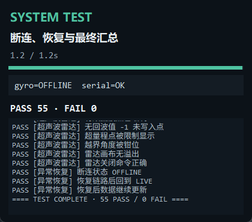

# 系统功能自动化测试报告

- 生成时间：2026-10-31 12:23:35 +0800
- 总体结果：**通过**
- 断言：55 通过 / 0 失败
- 环境：Windows 11，Python 3.13.15，Tk UI 缩放 1.250
- 虚拟串口：COM5 HC-05（无真实硬件）

## 模块覆盖与结论

| 功能模块 | 用例数 | 通过 | 失败 | 结论 |
|---|---:|---:|---:|---|
| 协议单元回归 | 1 | 1 | 0 | 通过 |
| 界面与 DPI | 2 | 2 | 0 | 通过 |
| 电脑状态 | 3 | 3 | 0 | 通过 |
| 串口与协议 | 10 | 10 | 0 | 通过 |
| 日志与反馈 | 3 | 3 | 0 | 通过 |
| 异常恢复 | 4 | 4 | 0 | 通过 |
| 舵机与控制 | 3 | 3 | 0 | 通过 |
| 传感器数据 | 5 | 5 | 0 | 通过 |
| 异常数据 | 1 | 1 | 0 | 通过 |
| 温度曲线 | 8 | 8 | 0 | 通过 |
| 基础通信 | 1 | 1 | 0 | 通过 |
| 陀螺仪 | 5 | 5 | 0 | 通过 |
| 超声波雷达 | 9 | 9 | 0 | 通过 |

## 前台测试台证据



主界面在每个长时阶段同步显示实时数据与测试状态；三张阶段截图如下：

- [陀螺仪阶段](../test-results/system_gyro.png)
- [温度曲线阶段](../test-results/system_temperature.png)
- [雷达阶段](../test-results/system_radar.png)

## 长时可视化验证

| 模块 | 要求 | 实际展示 | 数据量 | 状态/结果 | 证据 |
|---|---:|---:|---|---|---|
| 陀螺仪 | ≥5.0s | 6.40s | 53 帧 | 状态 DATA ERR/HOLD/LIVE/OFFLINE | [截图](../test-results/system_gyro.png) |
| 温度曲线 | ≥5.0s | 5.61s | 13 帧 | 曲线 13 点 | [截图](../test-results/system_temperature.png) |
| 超声波雷达 | ≥5.0s | 5.62s | 105 帧 | 曲线 91 点，角度 96 种 | [截图](../test-results/system_radar.png) |

## 分类用例明细

### 协议单元回归

| 用例 | 结果 | 观测值 |
|---|---|---|
| selftest.py 完整回归 | PASS | 79 通过 / 0 失败 |

### 界面与 DPI

| 用例 | 结果 | 观测值 |
|---|---|---|
| 主窗口和三栏完成构建 | PASS |  |
| UI 缩放已计算 | PASS | scale=1.250 |

### 电脑状态

| 用例 | 结果 | 观测值 |
|---|---|---|
| 性能圆环绘制 | PASS | 25 |
| 不支持 PC 时只提示一次 | PASS |  |
| PC 帧全整数且字段完整 | PASS | 86 |

### 串口与协议

| 用例 | 结果 | 观测值 |
|---|---|---|
| PONG 更新在线状态 | PASS | 在线 @ 115200 |
| PING 命令编码 | PASS |  |
| 关闭 CRLF 后原样发送 | PASS |  |
| HEX 合法输入 | PASS | b'\xaaU\x01' |
| HEX 非法输入返回 None | PASS |  |
| HEX 界面发送实际字节 | PASS |  |
| 非法 HEX 不发送 | PASS |  |
| 命令历史记录与回填 | PASS | ['AA 55 01', 'ZZ', 'PING'] |
| ↑ 历史命令回填 | PASS | PING |
| 同步波特率走旧链路发送 | PASS | 19200 |

### 日志与反馈

| 用例 | 结果 | 观测值 |
|---|---|---|
| 版本与错误应答进入日志 | PASS |  |
| 时间戳前缀与清空功能 | PASS | 12:23:14 timestamp check |
| 版本与错误应答进入日志 | PASS |  |

### 异常恢复

| 用例 | 结果 | 观测值 |
|---|---|---|
| 未连接时发送被拒绝 | PASS |  |
| 断连状态 OFFLINE | PASS |  |
| 恢复链路后回到 LIVE | PASS | ('LIVE', '#4fc3a1', '') |
| 恢复后数据继续更新 | PASS | (6.5, -3.0) |

### 舵机与控制

| 用例 | 结果 | 观测值 |
|---|---|---|
| 滑条发送 SERVO,125 | PASS |  |
| 锁定发送 LOCK,1 | PASS |  |
| 遥测发送 STREAM,1,500 | PASS |  |

### 传感器数据

| 用例 | 结果 | 观测值 |
|---|---|---|
| +DATA 全字段解析 | PASS | {'light': 82, 'temp': 25.34, 'servo': 125, 'lock': 0} |
| 传感器标签同步 | PASS | 82 |
| 边界字段接收 | PASS | (180, 90.0) |
| 旧版 6 字段 $D 兼容 | PASS | 21.5 |
| 11 字段 $D 遥测解析 | PASS | (28.56, -4.5) |

### 异常数据

| 用例 | 结果 | 观测值 |
|---|---|---|
| NaN 帧不抛异常且不污染姿态 | PASS | -180.0 |

### 温度曲线

| 用例 | 结果 | 观测值 |
|---|---|---|
| 历史缓存上限 120 | PASS | 120 |
| 持续展示不少于 5 秒 | PASS | 5.61s |
| 2.5Hz 持续采样更新 | PASS | 13 |
| 温度历史逐帧增长 | PASS | 13 |
| 曲线已绘制 | PASS | 3 |
| 坏帧不追加数据点 | PASS | (13, 13) |
| 温度范围符合注入数据 | PASS | (10.39, 37.96) |
| 画布内容无溢出 | PASS |  |

### 基础通信

| 用例 | 结果 | 观测值 |
|---|---|---|
| 基础阶段时长有效 | PASS | 0.91s |

### 陀螺仪

| 用例 | 结果 | 观测值 |
|---|---|---|
| 持续展示不少于 5 秒 | PASS | 6.40s |
| 20Hz 连续采样并驱动姿态 | PASS | 53 |
| 姿态画面持续变化 | PASS | 47 |
| 画布内容有效无溢出 | PASS | 29 |
| 状态覆盖 LIVE/HOLD/DATA ERR/OFFLINE | PASS | ['DATA ERR', 'HOLD', 'LIVE', 'OFFLINE'] |

### 超声波雷达

| 用例 | 结果 | 观测值 |
|---|---|---|
| 持续展示不少于 5 秒 | PASS | 5.62s |
| 20Hz 帧持续更新 | PASS | 105 |
| 扫描角度发生变化 | PASS | 96 |
| 有效回波点已绘制 | PASS | 91 |
| 无回波值 -1 未写入点 | PASS |  |
| 超量程点被限制显示 | PASS |  |
| 越界角度被钳位 | PASS | 180 |
| 雷达画布无溢出 | PASS |  |
| 雷达关闭命令正确 | PASS | b'RADAR,0\r\n' |

## 覆盖范围

- 界面与 DPI：主窗口、三栏、画布、缩放因子、控件边界。
- 协议与通信：PING/GET、CRLF、HEX、PONG、版本和错误应答日志。
- 控制：舵机角度、锁定、周期遥测、雷达开关。
- 数据：`+DATA` 全字段、6/11 字段 `$D`、边界值、NaN、坏帧。
- 展示：电脑状态圆环、传感器标签、历史缓存、PC 帧。
- 长时：3D 姿态仪、温度曲线、超声波雷达各至少 5 秒。
- 异常恢复：超时 HOLD、非法帧 DATA ERR、断连 OFFLINE、恢复 LIVE。

## 测试边界

- 串口传输由 FakeSerial 模拟，验证协议层和 UI 响应；真实蓝牙配对、
  CH340 驱动、线缆与供电质量需在目标硬件上复测。
- 电脑性能数据由固定虚拟快照提供；真实 PDH、DWM、HWiNFO 读数
  受机器环境影响，状态提示逻辑已覆盖。
- 长时测试使用真实 Tk 事件循环和 30fps 动画，但时间为自动化调度，
  不替代老化测试。

## 虚拟数据概况

- 陀螺仪：0.05s 间隔注入正弦姿态，53 帧；覆盖 DATA ERR/HOLD/LIVE/OFFLINE。
- 温度：0.4s 间隔注入 10.39–37.96℃，13 帧；包含格式错误帧。
- 雷达：0.05s 间隔扫描 105 帧、96 种角度；包含 -1 无回波、250cm 超量程和 999° 越界。
- 基础用例另覆盖：0/180° 舵机、±2000mg 加速度、±90° 俯仰、NaN、旧 6 字段帧。

## 可复现命令

```bat
python tools/system_test.py
python tools/system_test.py --hold
python selftest.py
```

主测试脚本使用固定随机序列和固定时间表，不依赖真实串口或本机性能数据。
